# ShellMind

**The self-hosted workspace for sysadmins and DevOps engineers: SSH terminals, files, operations, fleet health and an AI assistant that works from real evidence, in one desktop app.**

ShellMind 1.0 runs on Windows, macOS and Linux as a desktop app, or on your own server as a web app. It connects to Linux and Windows servers over SSH, to FTP/FTPS and S3-compatible storage, to Windows desktops over RDP, and to the shells and cloud CLIs of your own machine. Credentials stay on the machine that runs ShellMind, encrypted at rest.

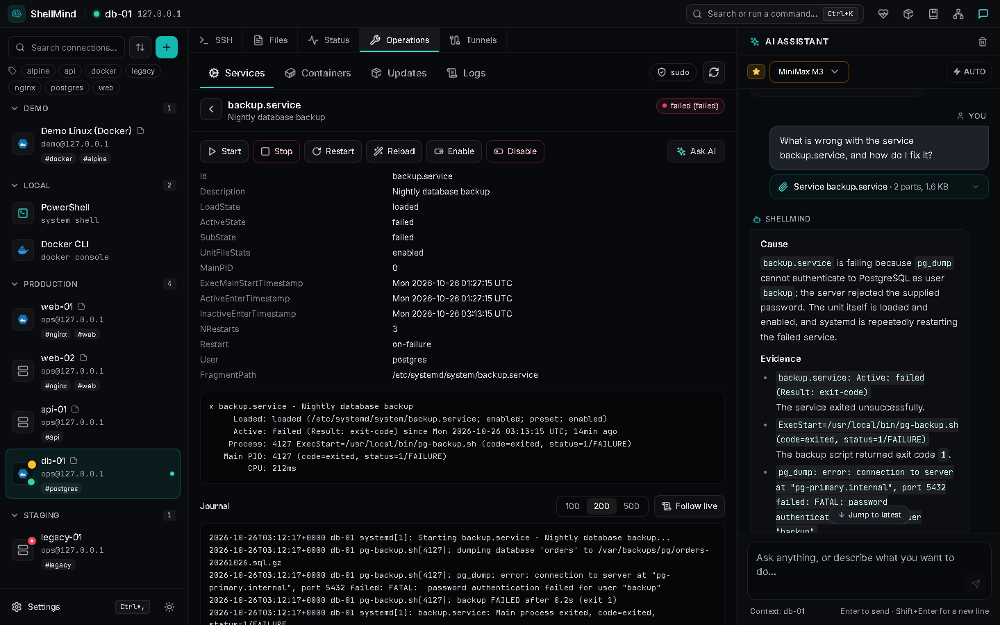

- [What's new in 1.0](#whats-new-in-10)
- [Screenshots](#screenshots)
- [Features](#features)
- [Download](#download)
- [Getting started from source](#getting-started-from-source)
- [Self-hosting the web app](#self-hosting-the-web-app)
- [Configuration reference](#configuration-reference)
- [Your data and the data key](#your-data-and-the-data-key)
- [Building the installers](#building-the-installers)
- [Testing](#testing)
- [Security](#security)
- [Project structure](#project-structure)
- [Changelog and license](#changelog-and-license)

## What's new in 1.0

1.0 is a rewrite of almost everything since 0.3.3. The full list is in [CHANGELOG.md](CHANGELOG.md); the highlights:

- **Fleet health**: every SSH server on one board, with reachability and health checks in the background, alerts and desktop notifications.
- **Split panes and broadcast input**: up to four terminals side by side, and one line typed into several of them, with guards for password prompts and destructive commands.
- **Operations**: systemd and Windows services, Docker and Podman containers (with shells inside them), Compose projects, images, live logs, and a Kubernetes workspace for pods, workloads, events and nodes.
- **Patch center and disk toolkit**: pending and security updates across the fleet, patched in canary batches with an optional reboot; disk usage explorer, deleted-but-open files and cleanups with a preview.
- **Built-in Remote Desktop**: Windows desktops in a tab (IronRDP), through a gateway in the backend that pins each server's certificate.
- **AI diagnose**: "Ask AI" on a service, container, pod, log excerpt or status page attaches evidence collected on the server; one-click triage of a whole server.
- **Multi-exec jobs**: snippets with variables run on many servers as background jobs, with rolling batches, a canary, a failure limit, and output grouped by result.
- **Keychain**: shared identities, SSH agent support, ed25519 key generation, key install and rotation across servers.
- **Security**: a session token on every request, encrypted credentials, host keys pinned on first use (also behind jump hosts), an audit log of every command the app runs.
- **Themes and languages**: dark and light themes, accent colors, terminal color schemes, English and Spanish.

## Screenshots

| | |
|---|---|
| 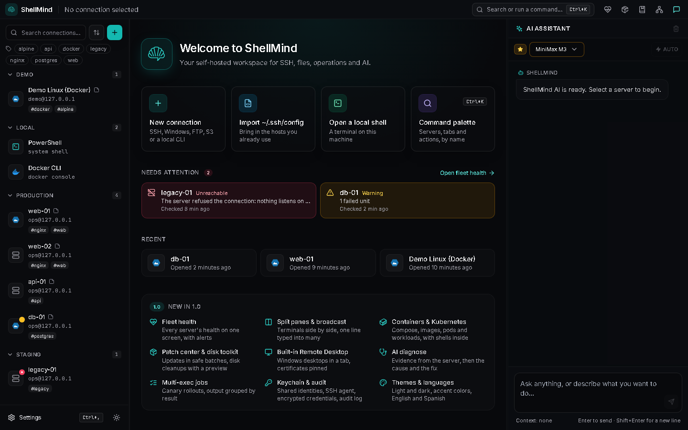 | 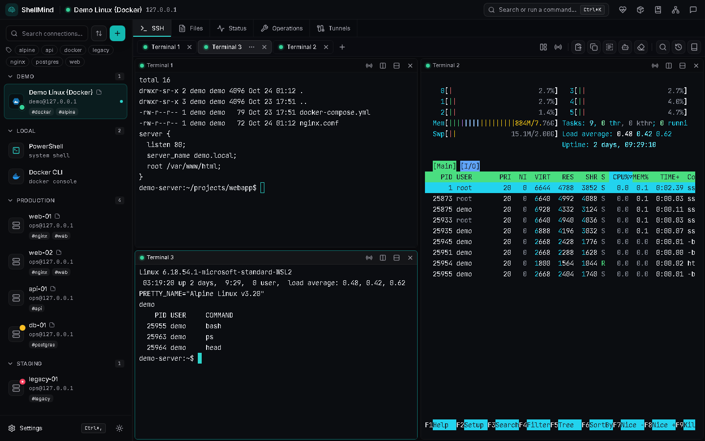 |
| **Welcome**: quick actions, servers that need attention, recent connections. | **Terminal**: split panes, tabs sharing one SSH connection. |
| 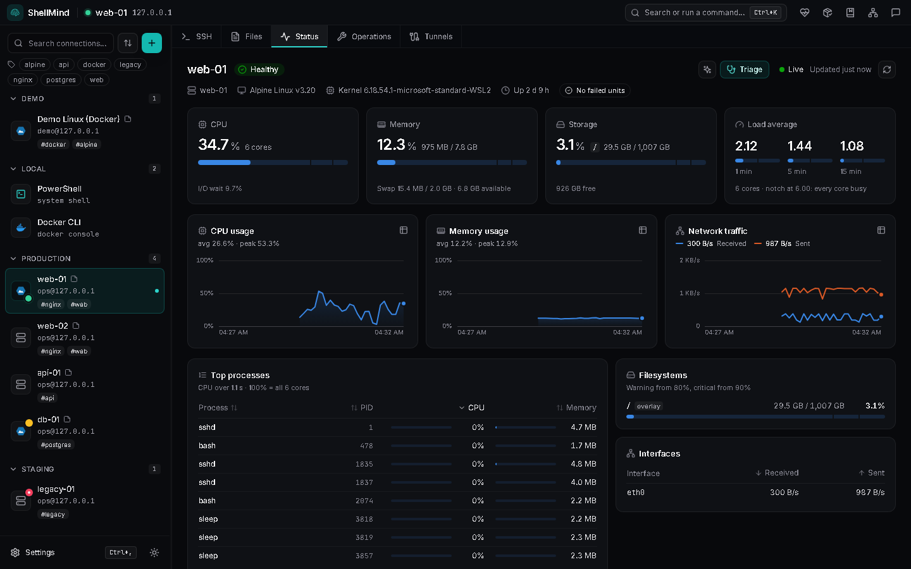 | 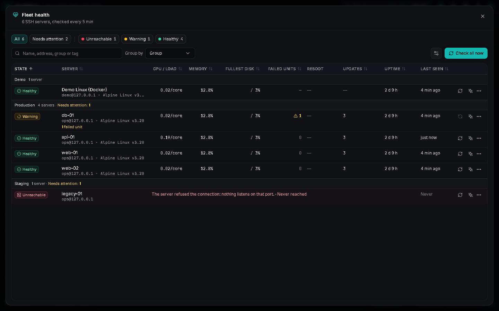 |
| **Status**: live dashboard, history, processes, filesystems. | **Fleet health**: every server at a glance, grouped and sorted by urgency. |
| 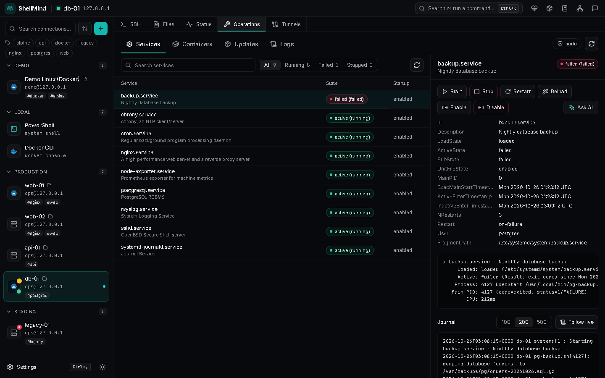 | 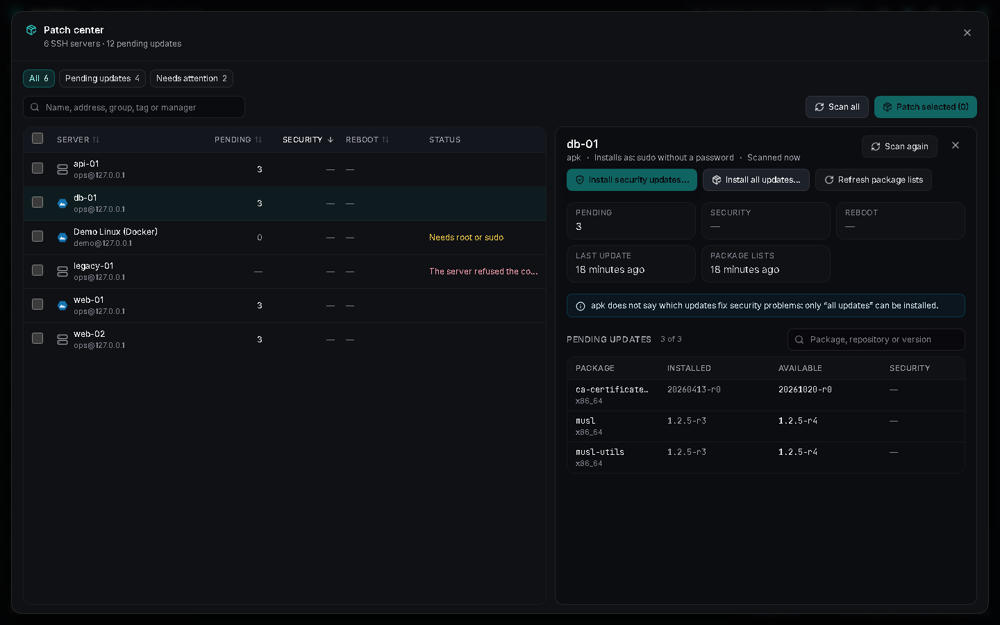 |
| **Operations**: services, containers, Compose, images, logs. | **Patch center**: pending updates across the fleet. |
| 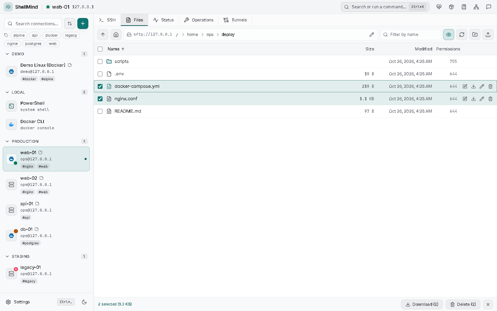 | 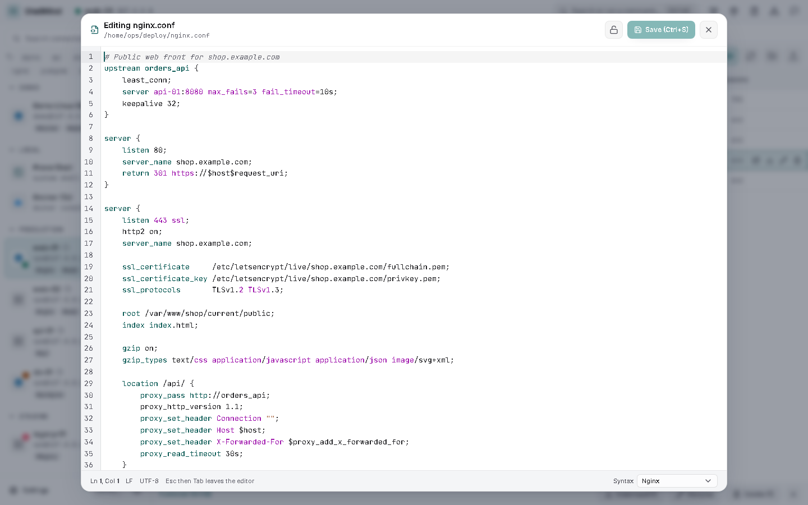 |
| **Files**: SFTP, FTP/FTPS and S3, bulk actions, streamed transfers. | **Editor**: edit remote files in place, with syntax highlighting. |
| 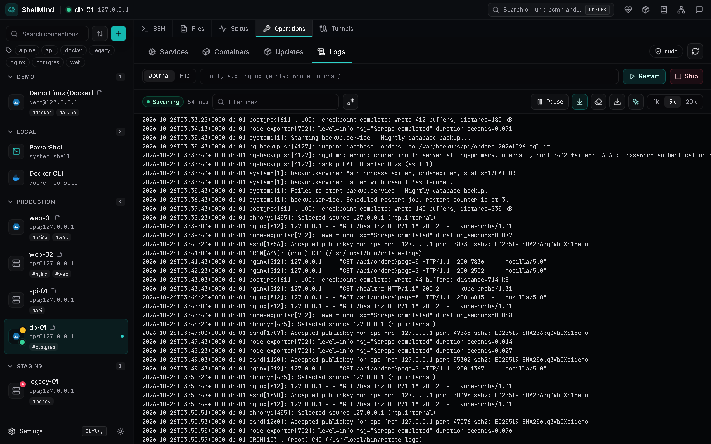 | 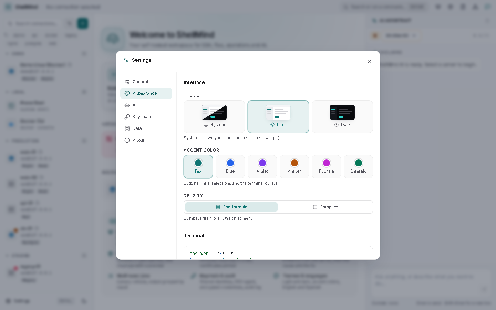 |
| **Live logs**: the journal, files, containers and Compose, followed live. | **Appearance**: themes, accents, density, terminal schemes. |

## Features

### Connections and organization

- **Server types**: Linux/Unix over SSH; Windows over SSH (OpenSSH Server) and RDP; FTP, FTPS (explicit and implicit); S3 and S3-compatible storage (AWS, MinIO and other endpoints); local consoles on the machine that runs ShellMind.
- **Local consoles**: the system shell (PowerShell on Windows, your login shell elsewhere) through a real PTY, scoped consoles for the Azure, AWS, Google Cloud, Kubernetes and Docker CLIs (an `az>`/`kubectl>`/`docker>` prompt that only runs that tool, with history, Tab completion and quick commands), or any command you configure.
- **Organization**: groups, tags, colors, favorites, notes, manual ordering, a sidebar search that matches names, addresses, groups and tags, and a command palette (Ctrl+K) for servers, tabs and actions.
- **Import and export**: import hosts from `~/.ssh/config` (including `ProxyJump`, key files and `IdentityAgent`); export and import the whole configuration as JSON, never with secrets. An imported server that would use one of your saved identities is only linked to it after you agree.
- **Several servers open at once**: recently used servers stay open in the background, so switching back is instant; ShellMind asks before closing one with unsaved edits, transfers or live terminals.

### Terminal and sessions

- **Multi-session**: any number of terminal tabs per server. SSH tabs, the file manager, the status dashboard and the operations panels of a server share one pooled SSH connection (spare connections are opened when the server's `MaxSessions` is reached).
- **Split panes**: up to four panes per server (Ctrl+Shift+D right, Ctrl+Alt+Shift+D down), resizable with the mouse or the keyboard, drag and drop of tabs between panes, the layout remembered per server.
- **Broadcast input** (Ctrl+Shift+B): type into several terminals, of one server or several. A line typed at a password prompt never leaves its terminal, terminals at a password prompt or running a full-screen program are skipped, and pastes and destructive commands ask first. Broadcast lines are recorded in the audit log.
- **Shells inside containers and pods**: open a terminal inside a running Docker/Podman container or a Kubernetes pod; when its tab closes, the shell inside is hung up.
- Clipboard (Ctrl+Shift+C / Ctrl+Shift+V, right-click, middle-click; Ctrl+C stays SIGINT), search, a command history that never stores what was typed at a password prompt, favorite commands, quick commands, clickable links, highlighted error lines, binary-safe UTF-8 output with flow control (Ctrl+C works even during a flood), and a screen reader mode.
- **Host keys**: trust on first use, pinned per host, port and jump route; a changed key stops the connection and shows both fingerprints.

### Files and editor

- **File manager** for SFTP, FTP/FTPS and S3: breadcrumb navigation, drag and drop uploads, multi-select with bulk download and delete, rename, new folder, filter, sortable columns.
- **Streamed transfers**: chunked uploads written to a temporary file and moved into place (a failed upload never leaves a half-written target), downloads streamed to disk, S3 multipart uploads, many SFTP requests in flight on high-latency links, cancel at any time.
- **Remote editor** (CodeMirror 6): syntax highlighting for common languages and config formats, search, and conflict detection when the file changed on the server since it was opened. Files up to 2 MB.

### Status and fleet health

- **Status dashboard** for Linux and Windows: CPU, memory and swap, the fullest filesystem, load per core, history charts, network traffic, top processes, filesystems and interfaces, failed units, uptime. It works on minimal systems such as Alpine (busybox) and reads Windows through PowerShell over SSH, also with an account that is not an administrator (with fewer details, such as no processor load, and the dashboard says why).
- **Fleet health board** (Ctrl+Shift+H): one row per SSH server with state, CPU/load, memory, fullest disk, failed units, pending reboot, pending updates (with security count), uptime and last check; filters, search, grouping by group or tag.
- **Background checks**: reachability checks are on by default and never log in; health checks (which do log in) are opt-in, every 1 to 60 minutes, with jitter, backoff for unreachable servers, and holds that stop retrying rejected credentials or changed host keys. A server behind a jump host waits for its jump host's check.
- **Alerts**: in-app toasts and desktop notifications when a server turns critical or unreachable, throttled per server; the welcome screen shows the servers that need attention, and the sidebar a health dot.

### Operations

The **Operations** tab of a Linux or Windows server:

- **Services**: systemd units (Linux) or Windows services: state and startup filters, details, the unit's journal (Linux), start, stop, restart, reload, enable, disable. Actions use `sudo -n` when the login user may run it without a password. On Windows an account that is not an administrator sees only the services it may query, and a refused action says so.
- **Containers** (Docker or Podman): list with live stats, details (health, ports, mounts, networks, environment masked until revealed), logs, start/stop/restart/remove, and a shell inside.
- **Compose projects**: `up -d`, pull and recreate, restart, stop and `down` (never with `-v` or `--rmi`), per project or per service, with the consequences in the confirmation.
- **Images**: in use, unused and dangling, disk usage, removal, and prunes (dangling, unused, build cache) with a preview of the space they free.
- **Live logs**: the journal (whole or per unit), any log file (`tail -F`; `Get-Content -Wait` on Windows), a container, a Compose project or service. Select lines and ask the AI about them.
- **Updates**: the server's view of the patch center.

**Kubernetes** (a tab for Linux servers where kubectl is found, and for local kubectl consoles): contexts and namespaces, workloads with ready counts (restart, scale), pods with crash-loop and image-pull problems highlighted, events, nodes (cordon, uncordon), pod details, logs (previous instance, follow, filter, download) and a shell in any container. Every call names its context explicitly; kubectl's current context only changes from an explicit menu item. On a Linux server the tab appears once kubectl has been found there (after the terminal connects, or from the palette entry "Kubernetes: look for kubectl on this server").

**Patch center** (header button): pending and security updates and pending reboots of every SSH server, read from the package managers' caches without refreshing them (apt, dnf, yum, zypper, apk, pacman; Windows Update is listed, never installed). Patch runs are multi-exec jobs: security or all updates, an optional refresh first, a canary on by default for three or more servers, a failure limit, and an optional reboot that waits for the server to come back and checks its services. Privileges come from root or `sudo -n` only; ShellMind never types a sudo password.

**Disk toolkit** (from the Status page or the palette): usage explorer per directory, largest files, deleted files still held open by processes (and how much space they hold), and cleanups with a preview of what they free: journal vacuum, package caches, rotated logs, temporary files, core dumps, Docker dangling/unused images, build cache and stopped containers; on Windows temporary files, the Windows Update cache, the recycle bin and the component store (DISM). Every cleanup is recorded in the audit log.

### Remote Desktop

- **Built-in RDP client** for Windows servers, based on IronRDP (WebAssembly): the session follows the panel size or uses a fixed resolution, scale to fit, full screen with keyboard lock, Ctrl+Alt+Del and a menu of special keys, text clipboard in both directions, Unicode or scancode keyboard mode.
- The browser talks to a gateway in the ShellMind backend, never to the server directly: the destination always comes from the saved server, the server's TLS certificate is pinned on first use (a changed certificate is shown side by side before you trust it), and sessions can go through an SSH jump host.
- **External client**: open the server in `mstsc` (Windows), as an `.rdp` file (macOS), or in `xfreerdp`/Remmina (Linux), or download the `.rdp` file.

### Tunnels and jump hosts

- **SSH tunnels** (local port forwarding, `ssh -L`): per server, started and stopped from the Tunnels tab or automatically when ShellMind starts; listening on loopback unless you confirm a public address.
- **Jump hosts** (`ProxyJump`): any saved SSH server can be the jump host of another, in chains; terminals, files, status, operations, tunnels, health checks and RDP all go through it.
- **Known hosts**: the pinned SSH host keys with their jump route and the servers that use them, which you can remove so the next connection trusts the key again.

### Identities, keychain and SSH agent

- **Identities** (Settings > Keychain): a username with a password, a private key (with its passphrase) or the SSH agent, shared by any number of servers. A field saved on the server itself wins over its identity.
- **Keys**: generate ed25519 keys, install a public key on many servers (appended idempotently to `authorized_keys`, `administrators_authorized_keys` on Windows, then checked by signing in with the key alone), and rotate a key safely: the new key is installed and checked everywhere before the stored one is replaced, then the previous key is taken out of those servers' authorized keys (unless you keep it), so a leaked copy stops working.
- **SSH agent**: OpenSSH's `ssh-agent` (or any agent in `SSH_AUTH_SOCK`), the Windows OpenSSH agent and Pageant. Agent forwarding is off by default and can be turned on per server, for interactive terminals only.

### Snippets and multi-exec jobs

- **Snippets** (Ctrl+Shift+S): a library of commands with `{{variables}}`, global or scoped to one server, run in a terminal or on many servers. Variables named like secrets (`{{password}}`, `{{secret:token}}`, ...) or marked secret are masked everywhere: in the audit log, the job history, the terminal history and what the AI reads.
- **Multi-exec** (Ctrl+Shift+E): run a command or snippet on many SSH servers as a background job that survives closing the dialog: all at once with a concurrency limit, rolling batches, or a canary first (wait for approval or continue when it passes), a failure limit, pause, resume and cancel.
- **Results grouped by output** ("6 identical, 2 different"), with host names, dates and PIDs normalized, a line diff between groups, export to JSON, CSV or text, and "run again where it failed". Destructive commands need you to type the number of servers.

### AI assistant

- **Models**: MiniMax M3 (default) and MiniMax M3.1 Flash; Gemini 3.8 Flash, Gemini 3.5 Flash-Lite and Gemini 4 Argon with your own Gemini API key. A model that fails with a rate limit or overload before answering falls back to its sibling once.
- **MiniMax without a key** goes through the ShellMind proxy, as described in the [legal notice](https://shellmind.app/legal.html#ai-data); **with your own MiniMax key** requests go directly to MiniMax's API. The chat explains which route is used, and what is sent, before the first request.
- **Context**: the assistant knows the active server, its OS and shell, recent terminal output (known secret formats masked) and the conversation, which is kept per server.
- **Diagnose and triage**: "Ask AI" on a service, container, pod, selected log lines, the status page or a fleet row collects read-only evidence on the server, shows you every part of it before anything is sent, and the answer comes as cause, evidence and fix. Triage collects failed units, recent errors, kernel and OOM messages, disk, memory, busy processes and listening ports in one go.
- **Run and Auto-Run**: code blocks run in the terminal with one click. Auto-Run types the answer's commands, reads their output and continues, up to five steps; destructive commands always wait for your approval, it never runs the fix of a diagnosis, and it turns off when you switch servers or close the chat.
- **Fix it**: common SSH and command failures detected in the terminal get an explanation and a fix suggestion.

### Audit log

Every command ShellMind runs or types for you is recorded: AI runs and Auto-Run steps, snippets, multi-exec jobs, operations actions (services, containers, Compose, Kubernetes, patching, cleanups), broadcast lines, container and pod shells, identity installs, fleet settings and RDP sessions. Search, filters per source and server, and a retention of 30, 90 (default), 180 or 365 days or unlimited (Ctrl+Shift+L).

### Appearance and languages

Dark, light or system theme, six accent colors, comfortable or compact density, terminal color schemes and font size, and the interface in English or Spanish (detected from the system, or chosen in Settings).

### Desktop and self-hosted web

The desktop app supervises its own backend on a random loopback port with a fresh session token per launch and keeps the data key in the OS keychain. The same code runs as a self-hosted web app (`npm run serve`) behind a reverse proxy, with an access token screen.

### Keyboard shortcuts

On macOS, Ctrl is Cmd (and the terminal copies, pastes and searches with Cmd+C, Cmd+V and Cmd+F).

| Shortcut | Action |
|---|---|
| Ctrl+K, Ctrl+Shift+P | Command palette (Ctrl+Shift+P also inside the terminal) |
| Ctrl+Shift+A | Show or hide the AI chat |
| Ctrl+, | Settings |
| Ctrl+1 ... Ctrl+9 | Workspace tab by position |
| F6 / Shift+F6 (Ctrl+F6 in the terminal) | Next / previous region of the window |
| Ctrl+Shift+H | Fleet health |
| Ctrl+Shift+S | Snippets |
| Ctrl+Shift+E | Multi-exec |
| Ctrl+Shift+L | Audit log |
| Ctrl+Shift+T / Ctrl+Shift+W | New / close terminal tab (desktop app) |
| Ctrl+Shift+C / Ctrl+Shift+V / Ctrl+Shift+F | Copy / paste / search in the terminal |
| Ctrl+Shift+D / Ctrl+Alt+Shift+D | Split the terminal right / down |
| Ctrl+Alt+Arrows or Alt+Shift+Arrows / Ctrl+Alt+Shift+Arrows | Focus / resize panes |
| Ctrl+Shift+B | Broadcast input on or off |
| Ctrl+Alt+Home | Give the keyboard back from a Remote Desktop session |

GNOME (Ubuntu, Fedora) takes Ctrl+Alt+Arrows to switch workspaces, and some Intel graphics drivers on Windows to rotate the screen, before ShellMind sees them: use Alt+Shift+Arrows there. Splitting, the next pane and broadcast input are also in the command palette ("split", "broadcast", "dividir", "simultánea"), and so is the keychain.

## Download

Installers are attached to each [GitHub release](https://github.com/Luisbh-dev/shellmind/releases):

| Platform | Package |
|---|---|
| Windows 10/11 (x64) | `ShellMind-Setup-1.0.0-x64.exe` (installer) |
| Linux (x64) | `ShellMind-1.0.0-x86_64.AppImage` and `shellmind_1.0.0_amd64.deb`, for glibc 2.31 or later (Debian 11, Ubuntu 20.04, Fedora, RHEL/Rocky 9 and newer) |
| macOS, Apple silicon | `ShellMind-1.0.0-arm64.dmg` (or `.zip`) |
| macOS, Intel | `ShellMind-1.0.0-x64.dmg` (or `.zip`) |

`SHA256SUMS.txt` on the release lists the checksum of every package (`sha256sum -c SHA256SUMS.txt --ignore-missing` in the download folder), and `gh attestation verify <package> --repo Luisbh-dev/shellmind` checks that the release workflow built it.

The packages are **not code-signed** yet, so the operating system warns the first time:

- **Windows**: SmartScreen says "Windows protected your PC". Choose **More info**, then **Run anyway**.
- **macOS**: the app is signed ad hoc, not notarized, so Gatekeeper refuses to open an app from an unidentified developer. Right-click (or Control-click) ShellMind in Applications and choose **Open**, then **Open** again; or remove the quarantine flag in a terminal: `xattr -dr com.apple.quarantine /Applications/ShellMind.app`.
- **Linux (AppImage)**: make it executable (`chmod +x ShellMind-*.AppImage`) and run it. Install the `.deb` with `sudo apt install ./shellmind_*.deb`; on Ubuntu 24.04 and later prefer the `.deb`, which installs the AppArmor profile Electron's sandbox needs there.

Upgrading from 0.3.x keeps your servers and settings: the database is migrated on first start and saved passwords and keys are encrypted with a new data key.

## Getting started from source

Requirements:

- **Node.js 24.15 or later** (the version in `.nvmrc`), or 22.22.2 or later in the 22 line, and npm.
- **Git**.
- On Linux distributions older than glibc 2.38 (Debian 12, Ubuntu 22.04, RHEL 9), `python3`, `make` and a C++ compiler: the install rebuilds sqlite3 from source there (`scripts/check-native.mjs`).
- Optional: a C++ toolchain for ssh2's native crypto binding (faster SSH); without it SSH still works.

```bash
git clone https://github.com/Luisbh-dev/shellmind.git
cd shellmind
npm ci
npm start
```

`npm start` runs the backend (with reload on change) on `http://127.0.0.1:3001` and the UI on `http://localhost:5173`. Open the UI in a browser: it is signed in automatically. The access token of the run is printed in the console, for other browsers and tools. To open the desktop shell instead, run `npm run electron:dev`.

Configuration is optional. Copy `.env.example` to `.env` and uncomment what you need, for example a fixed token or your own AI keys:

```env
SHELLMIND_AUTH_TOKEN=use-at-least-32-random-characters
MINIMAX_API_KEY=your-own-minimax-key
GEMINI_API_KEY=your-gemini-key
```

AI keys can also be entered in Settings > AI, where they are stored encrypted. MiniMax works without any key through the ShellMind proxy.

In development the database (`shellmind.db`) and its key (`shellmind.key`) are created in the project folder.

## Self-hosting the web app

ShellMind can run on a server you control and be used from a browser. The backend serves the built UI and the API from one origin:

```bash
npm ci
npm run build
npm run serve
```

`npm run serve` supervises the compiled backend (restarting it after a crash), serves the UI with compression, and listens on `127.0.0.1:3001` by default. Without `SHELLMIND_AUTH_TOKEN` it prints a new access token at every start; set one in `.env` (at least 32 random characters) so it stays the same. The browser asks for the token once per session, or remembers it on that device if you tick the box.

Keep `HOST` on loopback and put a reverse proxy with TLS in front. ShellMind refuses requests whose `Host` header is not a loopback name or listed in `ALLOWED_HOSTS` (DNS-rebinding protection), and requests from browser origins that are not loopback or listed in `ALLOWED_ORIGINS`. The UI served by the backend under an `ALLOWED_HOSTS` name may call the API from its own origin without being listed in `ALLOWED_ORIGINS`.

```env
HOST=127.0.0.1
PORT=3001
ALLOWED_HOSTS=shellmind.example.com
SHELLMIND_AUTH_TOKEN=use-at-least-32-random-characters
DB_PATH=/var/lib/shellmind/shellmind.db
```

An nginx example (WebSockets carry the terminals, files and the RDP gateway; Server-Sent Events carry chat answers and job progress):

```nginx
map $http_upgrade $connection_upgrade {
    default upgrade;
    ''      close;
}

server {
    listen 443 ssl;
    http2 on;
    server_name shellmind.example.com;

    ssl_certificate     /etc/letsencrypt/live/shellmind.example.com/fullchain.pem;
    ssl_certificate_key /etc/letsencrypt/live/shellmind.example.com/privkey.pem;

    client_max_body_size 16m;

    location / {
        proxy_pass http://127.0.0.1:3001;
        proxy_http_version 1.1;
        proxy_set_header Host $host;
        proxy_set_header Upgrade $http_upgrade;
        proxy_set_header Connection $connection_upgrade;
        proxy_buffering off;
        proxy_read_timeout 1h;
    }
}
```

Things to know:

- Everyone with the token has full control of every saved server. Treat it like a root password, and serve ShellMind only over HTTPS (large downloads also need a secure page).
- The local consoles (system shell, cloud CLIs) run on the machine that hosts ShellMind, as the user that runs it.
- The SSH agent of the backend's machine is only used for remote users when `SHELLMIND_SSH_AGENT` names it.
- If the API is served from another origin than the UI, build the UI with `VITE_API_BASE=https://api.example.com` and list the UI's origin in `ALLOWED_ORIGINS`.
- The database defaults to `shellmind.db` in the project folder (also for `node dist-server/server.js`); set `DB_PATH` to keep it elsewhere, such as `/var/lib/shellmind`.

## Configuration reference

Every setting is optional; the defaults suit `npm start`. The backend reads the environment and a `.env` file in its working directory (the project folder, or the data folder of the desktop app); `.env.example` documents each variable. The desktop app sets its own network, database, token and key settings; the AI, logging and SSH agent settings apply to it too.

| Variable | Default | Description |
|---|---|---|
| `PORT` | `3001` | Port of the backend (API, sockets, and the UI with `SERVE_WEB`). `0` picks a free port. |
| `HOST` | `127.0.0.1` | Interface the backend listens on. Keep it on loopback behind a reverse proxy. |
| `WEB_PORT` | `5173` | Port of the Vite dev server under `npm start`. |
| `ALLOWED_HOSTS` | (none) | Extra `Host` header values accepted, comma-separated: `name` (any port) or `name:port`. Loopback names are always accepted. |
| `ALLOWED_ORIGINS` | (none) | Extra browser origins allowed to call the API, comma-separated (`https://shellmind.example.com`). Their hosts are accepted in `Host` too. |
| `SERVE_WEB` | off (`1` under `npm run serve`) | Serve the built web UI from the backend. |
| `WEB_DIR` | `dist/` | Folder of the web build that `SERVE_WEB` serves. |
| `DB_PATH` | `shellmind.db` in the project folder | SQLite database (servers, settings, chat history, audit log...). |
| `SHELLMIND_AUTH_TOKEN` | generated at startup | Session token every request and socket must carry. When unset, a new one is printed at each start. |
| `SHELLMIND_DATA_KEY` | `shellmind.key` next to the database | Base64 32-byte key that encrypts the saved credentials (AES-256-GCM). |
| `SHELLMIND_RESET_DATA_KEY` | off | Start over with a new data key when the old one is lost; the credentials saved with it are cleared. |
| `LOG_LEVEL` | `info` | `error`, `warn`, `info` or `debug`. |
| `SHELLMIND_DEBUG` | off | Forces debug logging including every SSH packet and the FTP control channel. Logs then contain hosts, users and paths. |
| `GEMINI_API_KEY` | (none) | Gemini key; takes precedence over the one saved in Settings and locks that field. |
| `MINIMAX_API_KEY` | (none) | Your own MiniMax key; MiniMax requests then go directly to MiniMax. |
| `MINIMAX_PROXY_URL` | `https://ai-proxy.luisbh.com` | Proxy used for MiniMax without your own key. |
| `MINIMAX_PROXY_API_KEY` / `MINIMAX_PROXY_BEARER_TOKEN` | (none) | Credentials for a self-hosted proxy that needs them. |
| `MINIMAX_API_BASE_URL` | `https://api.minimax.io/anthropic` | MiniMax's Anthropic-compatible API (`https://api.minimaxi.com/anthropic` in China). |
| `ALLOW_CLIENT_MINIMAX_KEY` | `true` | When `false`, MiniMax always goes through the proxy, ignoring any MiniMax key. |
| `SSH_AUTH_SOCK` | inherited | SSH agent socket used by identities that sign in with the agent. |
| `SHELLMIND_SSH_AGENT` | (none) | Overrides the agent lookup: a socket or Windows pipe path, `pageant`, or `off`. Needed to use the local agent when `HOST` is not loopback. |
| `SHELLMIND_POWERSHELL_DELIVERY` | `stdin` | How scripts reach Windows servers: on the standard input of `powershell -Command -`, or `encoded` (`-EncodedCommand` on the command line) for an SSH server that does not pass stdin on. See [SECURITY.md](SECURITY.md#antivirus-and-edr). |
| `VITE_API_BASE` | (none) | Build time: the backend origin the web UI calls when it is not the origin that served it. Added to the UI's Content-Security-Policy. |

Set by the desktop app itself: `SHELLMIND_VERSION` and `SHELLMIND_ALLOW_FILE_ORIGIN` (it accepts the `file://` page of the app). The test-only variables are listed under [Testing](#testing).

## Your data and the data key

ShellMind keeps everything in one SQLite database: servers, identities, settings, snippets, tunnels, chat history, fleet snapshots, multi-exec jobs and the audit log. Passwords, private keys, passphrases, S3 secret keys and AI API keys in it are encrypted with AES-256-GCM using a 32-byte **data key**.

| | Database | Data key |
|---|---|---|
| Desktop app on Windows | `%APPDATA%\shellmind\shellmind.db` | `%APPDATA%\shellmind\data-key.enc`, encrypted by the OS keychain (DPAPI) |
| Desktop app on macOS | `~/Library/Application Support/shellmind/shellmind.db` | `data-key.enc` in the same folder, encrypted by the Keychain |
| Desktop app on Linux | `~/.config/shellmind/shellmind.db` | `data-key.enc` in the same folder, encrypted by the Secret Service or KWallet (a plain `data-key` file readable only by you when there is no keyring) |
| `npm start`, `npm run serve` | `shellmind.db` in the project folder, or `DB_PATH` | `shellmind.key` next to the database, or `SHELLMIND_DATA_KEY` |

The desktop app writes its backend log to `server.log` in the same folder.

> [!WARNING]
> **Back up the data key together with the database.** Without the key, the saved credentials cannot be decrypted by anyone, including you. ShellMind refuses to start rather than silently create a new key for a database that holds encrypted credentials; you can then restore the key, or start over (`SHELLMIND_RESET_DATA_KEY=1`, or "Start over" in the desktop app), which clears the saved credentials and keeps everything else.
>
> The desktop app's key is protected by the OS keychain of your user account: a copy of the data folder on another computer or account cannot read it. To move to another machine, export the configuration (Settings > Data, no secrets) and enter the credentials again, or run a self-hosted instance with your own `SHELLMIND_DATA_KEY`.

## Building the installers

```bash
npm ci
npm run dist
```

`npm run dist` builds the UI, the backend and the Electron shell, then packages them with electron-builder (`scripts/dist.mjs`) into `release/` (or `npm run dist -- --out <dir>`): the NSIS installer on Windows, a dmg and a zip on macOS. Each machine packages its own platform and architecture (the native modules, node-pty and sqlite3, are not cross-compiled).

- **Linux**: `npm run dist:linux` builds the AppImage and the `.deb` in a Debian 11 container (Docker, from any OS), where sqlite3 and node-pty are compiled against glibc 2.31, so the packages run on Debian 11, Ubuntu 20.04, Fedora, RHEL 9 and newer. The `afterPack` hook (`scripts/after-pack.mjs`) fails any Linux package whose native modules need a newer glibc or libstdc++.
- **macOS**: without a Developer ID the app is signed ad hoc, which Apple silicon requires to launch it.
- **Signing**: `WIN_CSC_LINK` / `WIN_CSC_KEY_PASSWORD` on Windows, `CSC_LINK` / `CSC_KEY_PASSWORD` and the `APPLE_*` notarization credentials on macOS, when they are set.
- **Smoke test**: `npm run smoke:packaged -- <installer or unpacked app> [--launch]` checks a package as it ships (the Windows installer is installed silently and uninstalled again): nothing but the app inside, built from the checkout's current commit, the Electron fuses, the native modules, and the bundled backend on a fresh database (health, token, every migration, an encrypted password); `--launch` also starts the app. `node scripts/smoke-linux-distros.mjs <dir>` runs it on Debian, Ubuntu and Fedora containers.

The package never contains a database, key file or `.env`, and the Electron fuses disable `NODE_OPTIONS` and the inspector and enforce `app.asar` integrity. Releases are built by `.github/workflows/release.yml` from a version tag: see [docs/RELEASING.md](docs/RELEASING.md).

## Testing

```bash
npm run typecheck   # app, server, Electron, tests and contract tests
npm run lint        # ESLint, no warnings allowed
npm test            # Vitest: unit, integration (HTTP API, in-process SSH server) and component tests
npm run test:coverage
```

The unit and integration suites need no network: an in-process SSH server (`test/helpers/sshServer.ts`) stands in for real hosts, and each integration file boots the real backend on a random port with a temporary database.

**End-to-end suites** (opt-in, `test/e2e/`) run against real servers in Docker: OpenSSH, vsftpd with FTPS, MinIO, Docker-in-Docker and Podman, a k3s cluster, Debian/Ubuntu/Rocky/Alpine for the patch center, and the built web UI in Chromium:

```bash
npm run build                    # the web UI suite drives dist/
npx playwright install chromium
npm run test:e2e                 # sets SHELLMIND_E2E=1; containers are named shellmind-test-*
npm run test:e2e -- test/e2e/fleet-sshd.test.ts   # one suite
```

The **end-to-end UI suite** (opt-in, `test/e2e-ui/`, Playwright) drives the whole app in Chromium the way a user does: connections, terminals with split panes and broadcast, files and the editor, status, the fleet board, operations, the patch center, the disk toolkit, tunnels, host keys, identities, multi-exec and the audit log, the AI chat (against a local mock provider) with diagnosis and Auto-Run, settings, the RDP tab (against a fake RDP server) and Kubernetes. It starts its own sshd containers (`shellmind-test-e2eui-*`), backend and Vite dev server with a temporary database, and never touches your data or a running ShellMind. [test/e2e-ui/README.md](test/e2e-ui/README.md) explains how to run and extend it.

```bash
npx playwright install chromium
SHELLMIND_E2E_UI=1 npm run test:e2e-ui                # every spec (a few minutes)
SHELLMIND_E2E_UI=1 npm run test:e2e-ui -- terminal    # specs whose file matches
```

The opt-in suites and their variables (the suites against your own Windows machine are skipped unless configured):

| Variable | Used by |
|---|---|
| `SHELLMIND_E2E` | `1` enables the Docker and browser suites under `test/e2e/` (`npm run test:e2e` sets it). |
| `SHELLMIND_E2E_UI` | `1` enables the end-to-end UI suite (`npm run test:e2e-ui`). |
| `SHELLMIND_E2E_WINDOWS`, `SHELLMIND_E2E_WINDOWS_PASSWORD` or `SHELLMIND_E2E_WINDOWS_KEY`, `SHELLMIND_E2E_WINDOWS_SERVICE`, `SHELLMIND_E2E_WINDOWS_CONTAINER` | Every Windows feature over SSH (`test/e2e/windows-ssh.test.ts`): `user@host:port`, its password or a private key file, and optionally a stopped service the test may start and stop and a running container. Use a throwaway account, administrator or not; the test also checks that no PowerShell process carries a script on its command line. |
| `SHELLMIND_E2E_RDP`, `SHELLMIND_E2E_RDP_PASSWORD` | The RDP gateway against a real Windows host: `user@host:port` and its password. |

CI (`.github/workflows/ci.yml`) type-checks, lints, tests and builds on Windows and on Debian 12 with npm 12 (with coverage floors), tests on Node 22, and packages and smoke-tests the Windows app and the Linux packages (in the Debian 11 build container) on every push; the macOS package and the `test/e2e/` suites run weekly. The end-to-end UI suite and the Windows suites run locally, before a release ([docs/RELEASING.md](docs/RELEASING.md)).

## Security

In short: every request and socket needs the session token; the backend binds to loopback and checks `Host` and `Origin`; the built UI runs under a strict Content-Security-Policy in a sandboxed, hardened Electron window; credentials are encrypted at rest and never sent to the browser (except the RDP password, handed to the built-in client once per connection); connection targets always come from the database; SSH host keys and RDP certificates are pinned on first use; and every command the app runs is audited, with secrets masked. Read [SECURITY.md](SECURITY.md) for the full model, what the AI providers receive, antivirus/EDR notes, and how to report a vulnerability.

## Project structure

```
server.ts      backend entry (compiled to dist-server/server.js)
server/        backend: HTTP routes, sockets, SSH pool, files, ops, fleet, AI, RDP gateway, database
shared/        code shared by the backend and the UI: protocol, types, parsers, safety checks
src/           React UI: workspace tabs, global actions, features, store, i18n
electron/      desktop shell: backend supervisor, data key, window hardening
scripts/       dev runner, self-hosting runner, CSP, packaging checks
test/          integration, contract, build, Electron and end-to-end tests, helpers and fixtures
```

[docs/ARCHITECTURE.md](docs/ARCHITECTURE.md) explains the layers, protocols, data model, SSH pool, file transfers, the AI pipeline, the frontend registries and the release process.

## Changelog and license

See [CHANGELOG.md](CHANGELOG.md) for every release.

MIT License. Created by [Luisbh-dev](https://github.com/Luisbh-dev).
