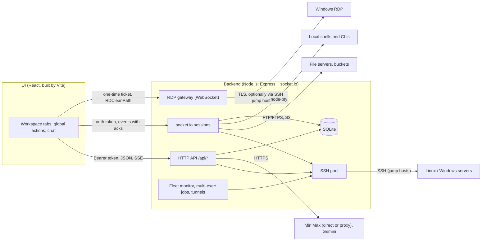

# ShellMind architecture

This document describes how ShellMind 1.0 is built: the processes and layers, the modules of the backend and the UI, the HTTP and socket protocols, the data model, the SSH connection pool, file transfers, the AI pipeline, the frontend registries, how it is tested and how a release is made. File paths are relative to the repository root.

## Runtime overview



ShellMind runs in three ways, all with the same backend and UI code:

| Mode | Backend | UI | Token |
|---|---|---|---|
| Desktop (`electron/`) | `dist-server/server.js` forked by the Electron main process on a free loopback port (`PORT=0`), supervised and restarted | `dist/index.html` loaded from `file://` with `?api=&token=` | new per launch |
| Development (`npm start`, `scripts/dev.mjs`) | `tsx watch server.ts` on port 3001 | Vite dev server on 5173 (the token reaches the page in a `<meta>` written by `scripts/devSession.ts`) | new per run, or `SHELLMIND_AUTH_TOKEN` |
| Self-hosted (`npm run serve`, `scripts/serve.mjs`) | compiled backend, supervised with the same supervisor as the desktop app (`electron/backend.ts`), serving `dist/` itself (`SERVE_WEB=1`) | same origin as the API | `SHELLMIND_AUTH_TOKEN` or printed at startup |

The backend reports startup to a parent process over IPC (`{type:"ready", port}` or `{type:"fatal", message}`, `server/lifecycle.ts`). An uncaught exception kills it on purpose (per-connection state may be half-updated); the parent restarts it within a crash budget (`electron/restartBudget.ts`).

## Repository layout and build targets

```
server.ts          backend entry; imports server/config first (loads .env)
server/            backend modules (CommonJS build in dist-server/)
shared/            framework-free code imported by both sides
src/               React UI (Vite build in dist/)
electron/          desktop shell (CommonJS build in dist-electron/)
scripts/           dev and serve runners, CSP, theme boot script, packaging checks
test/              integration, contract, build, Electron and e2e tests; helpers, fixtures
```

| tsconfig | Covers | Output |
|---|---|---|
| `tsconfig.app.json` | `src/`, `shared/` | type-check only; Vite bundles |
| `tsconfig.server.json` | `server.ts`, `server/`, `shared/` | `dist-server/` (CommonJS, `rootDir: "."`) |
| `tsconfig.electron.json` | `electron/` | `dist-electron/` |
| `tsconfig.test.json`, `tsconfig.contract.json` | tests, config files, contract tests | type-check only |

Rules enforced by ESLint and tests:

- `shared/` imports nothing from Node, the DOM, React, Express or socket.io. The server imports it by relative path; the UI through the `@shared/*` alias.
- The status, operations, snippets, multi-exec, audit, tunnels and known-hosts features reach each other only through their `public.ts`, and no import cycle may exist between features (`test/build/featureBoundaries.test.ts`).
- Backend settings are read in `server/config.ts`, which loads `.env` and is imported before anything else; `.env.example` must document every variable the backend reads (`test/build/envExample.test.ts`).

## Backend

### Entry and HTTP stack

`server/main.ts` exposes `createShellMindServer()` (builds Express, the HTTP server, socket.io and the RDP gateway without listening; tests use it) and `start({port, host})`, which opens and migrates the database before listening, then starts the tunnel auto-start, the audit retention timer and the fleet monitor.

`server/http/app.ts` mounts, in order:

1. `securityHeaders()` (nosniff, frame deny, no referrer, `no-store` on `/api/`).
2. `networkGuard()` (`server/http/network.ts`): 403 for a `Host` that is not loopback or listed (`ALLOWED_HOSTS`, hosts of `ALLOWED_ORIGINS`), and for an `Origin` that is not loopback, the request's own origin, `ALLOWED_ORIGINS`, or (desktop only) `null`/`file://`.
3. `serveWebUi()` when `SERVE_WEB` (static files, Brotli/gzip, `index.html` marked with `<meta name="shellmind-api" content="same-origin">`).
4. CORS for the allowed origins (preflights carry no token).
5. `GET /api/health` (public: `{ok, version}`).
6. `requireAuth(token)`: `Authorization: Bearer`, constant-time comparison (`server/auth.ts`).
7. JSON body parser: 1 MB, 8 MB for `/api/chat`, chat history and imports.
8. Routers from `server/http/routes/<area>.ts`, then the 404 and error handlers.

Errors use one envelope, `{error, code?, details?}` (`server/http/respond.ts`, `AppError` in `server/errors.ts`); the UI reads it through `ApiError` and translates known codes.

### HTTP API

All routes except `/api/health` need the token.

| Area | Routes |
|---|---|
| Session | `GET /api/health`, `GET /api/session` |
| Servers | `GET/POST /api/servers`, `PUT/DELETE /api/servers/:id`, `POST /api/servers/reorder`, `PATCH /api/servers/:id/os`, `PATCH /api/servers/:id/favorite`, `GET /api/servers/:id/host-key` |
| Import/export | `GET /api/export`, `POST /api/import/preview`, `POST /api/import[?link_credentials=1]`, `POST /api/import/ssh-config/preview`, `POST /api/import/ssh-config/apply` |
| Identities | `GET/POST /api/identities`, `PUT/DELETE /api/identities/:id`, `GET /api/identities/agent`, `POST /api/identities/assign`, `POST /api/identities/:id/install` and `/rotate` (SSE) |
| Known hosts | `GET /api/known-hosts`, `DELETE /api/known-hosts/:id` |
| Status | `GET /api/servers/:id/status` |
| Operations | `GET /api/servers/:id/ops/capabilities`; services `GET .../ops/services[/:name[/journal]]`, `POST .../ops/services/:name/:action`; containers `GET .../ops/containers[/:ref[/stats|/logs]]`, `GET .../ops/container-stats`, `POST .../ops/containers/:ref/:action`; Compose `GET .../ops/compose`, `POST .../ops/compose/:project/:action`; images `GET .../ops/images`, `GET .../ops/disk-usage`, `GET .../ops/images/prune-preview`, `POST .../ops/images/prune`, `POST .../ops/images/remove` |
| Kubernetes | `GET /api/servers/:id/k8s/{status,namespaces,workloads,pods,events,nodes,pods/:pod}`, `POST .../k8s/workloads/:kind/:name/{restart,scale}`, `POST .../k8s/pods/:pod/delete`, `POST .../k8s/nodes/:node/:action`, `POST .../k8s/use-context` |
| Disk toolkit | `GET /api/servers/:id/disk[/usage|/large-files|/deleted|/cleanups[/:cleanup]]`, `POST .../disk/deleted/release`, `POST .../disk/cleanups/:cleanup` |
| Patch center | `GET /api/patch/fleet`, `POST /api/patch/{scan,preview,apply}`, `GET /api/servers/:id/patch`, `POST .../patch/{scan,refresh}` |
| Fleet | `GET /api/fleet`, `POST /api/fleet/refresh`, `GET/PUT /api/fleet/settings` |
| Snippets | `GET/POST /api/snippets`, `POST /api/snippets/import`, `GET/PUT/DELETE /api/snippets/:id` |
| Multi-exec | `POST /api/multiexec`, `GET/DELETE /api/multiexec/jobs`, `GET/DELETE /api/multiexec/jobs/:id`, `GET .../jobs/:id/events` (SSE), `POST .../jobs/:id/{pause,resume,cancel}` |
| Tunnels | `GET/POST /api/servers/:id/tunnels`, `PUT/DELETE /api/tunnels/:id`, `POST /api/tunnels/:id/{start,stop}` |
| RDP | `GET /api/rdp/native`, `POST /api/rdp/launch`, `GET /api/rdp/certificate`, `DELETE /api/rdp/certificates/:id`, `GET/PUT /api/rdp/options` |
| AI | `POST /api/chat` (JSON or SSE), `POST /api/chat/evidence`, `GET/PUT/DELETE /api/chat/history/:serverId`, `GET /api/config/status`, `POST/DELETE /api/config/apikey`, `GET/POST /api/config/model` |
| Audit | `GET/POST /api/audit` (POST: the sources the interface reports, marked `meta.reportedBy: "client"`), `GET/PUT /api/audit/settings` |

Server-Sent Events (`server/http/sse.ts`, parsed by `shared/sse.ts` on both sides) carry chat answers, multi-exec job events and identity installs. The chat stream sends heartbeat comments so reverse proxies do not cut a model that thinks for a minute.

### Socket protocol

`shared/protocol.ts` types every event (`ClientToServerEvents`, `ServerToClientEvents`), and `server/sockets/io.ts` creates the typed socket.io server. The handshake must pass the same Host/Origin checks (`allowRequest`) and carry `auth.token`. WebSocket is tried first, long polling is the fallback.

**One socket is one session** (`server/sockets/session.ts`): each terminal tab, file panel, log viewer and the fleet feed open their own socket. `server/sockets/connection.ts` creates a `SocketSession` and registers every handler module on it; the session holds at most one backend connection at a time and is torn down on `disconnect`. A `generation` counter lets asynchronous steps of a replaced connection see that they are stale.

| Events | Purpose |
|---|---|
| `start-ssh {serverId, purpose: 'terminal'|'files', cols, rows, attach?}` | Open a session to a saved server. `terminal` opens a shell (SSH, local PTY or scoped CLI, FTP virtual shell); `files` opens only SFTP/FTP/S3. `attach` opens a shell inside a container or pod instead of the login shell. |
| `ssh-input`, `resize`, `ssh-ack` / `ssh-output`, `terminal-notice`, `ssh-error`, `ssh-closed`, `connection-ready`, `ftp-ready`, `os-detected` | Terminal I/O. Output is binary (UTF-8 bytes), batched per ~16 ms or 64 KiB, and flow-controlled by the client's byte acknowledgements (`server/sockets/terminalOutput.ts`). |
| `host-key-trusted`, `host-key-mismatch`, `trust-host-key` | TOFU host keys (with the jump route in `via`). |
| `files-*` | File manager requests, each answered through its own acknowledgement (see [File transfers](#file-transfers)). |
| `logs-start`, `logs-stop` / `logs-started`, `logs-chunk` (acked), `logs-error`, `logs-end` | Live logs: journal, files, containers, Compose, pods; at most three streams per socket. |
| `fleet-subscribe` (ack: the whole board), `fleet-unsubscribe` / `fleet-health` | Fleet board feed, changes batched every 150 ms. |
| `rdp-open` (ack: ticket and, for saved credentials, the password), `rdp-trust-certificate`, `rdp-disconnect` / `rdp-status` | Embedded RDP: tickets for the gateway, certificate trust, session state. |
| `launch-rdp-native` / `rdp-native-launched`, `rdp-error` | External RDP client. |

### Connection targets

`server/connections/target.ts` turns a saved server id into a target for a purpose (`terminal`, `files`, `status`, `exec`, `rdp`). Everything comes from the database row: host, port, user, secrets (decrypted), the jump chain (`servers.jump_server_id`, followed with loop and depth checks), the private key file path, and the identity (`servers.identity_id`), whose fields fill whatever the server leaves empty. Each private key keeps its own passphrase. A secret that cannot be decrypted fails with `SECRET_UNREADABLE` (409). The target carries a version that changes when the row, its identity or a hop of its chain changes, so pooled connections are replaced after an edit.

### SSH pool

`server/ssh/pool.ts` keeps **one SSH connection per saved server**, shared by every terminal tab, file session, status poll, operations call, fleet check and tunnel of that server:

- `sshPool.acquire(serverId)` returns a lease `{client, target, release(), onClose()}`; connections are reference-counted and closed 60 s after the last lease is released.
- Keepalive every 15 s (4 missed = dead), ready timeout 20 s, and a deadline for the whole jump route.
- **Jump hosts**: a connection to a server with `jump_server_id` first leases its jump host's pooled connection and opens a `forwardOut` channel through it, recursively.
- **Host keys** (`server/ssh/hostKeys.ts`, table `known_hosts`): pinned per `host`, `port` and `via` (the jump route, e.g. `bastion:22>inner:22`). The pool asks for the pinned key type first, so a server that gained a new key type still presents the pinned one. A mismatch fails with `HOST_KEY_MISMATCH` and both SHA-256 fingerprints.
- **Authentication**: password, private key (with passphrase), keyboard-interactive (a single hidden prompt answered with the saved password), and the SSH agent (`server/ssh/agent.ts`: `SHELLMIND_SSH_AGENT`, `SSH_AUTH_SOCK`, the Windows OpenSSH agent pipe, Pageant through ssh2's helper). Agent forwarding is requested only for interactive shells of servers that enable it, and a shell is reopened without it when sshd refuses.
- **Channel limits**: OpenSSH allows 10 sessions per connection by default. `server/ssh/exec.ts` caps commands at 4 channels (queued) and long-lived streams at 3 (fail fast with `EXEC_STREAMS_BUSY`); terminal shells take slots of their own, and up to 4 spare connections are opened when a server refuses another channel.
- `exec(lease, command, {timeoutMs, signal, stdin, maxOutputBytes})` collects at most 16 MB of output, decodes UTF-8 across chunk boundaries and kills the channel on timeout or abort; `execStream()` serves log tails with pause/resume for backpressure (its `input` is written to stdin, which then stays open).
- `sshPool.invalidate(id)` drops a server's connection after an edit, an identity change or a reboot.

Remote scripts are built in `server/ops/remote.ts`, and the login shell only ever parses a short, fixed command: POSIX scripts go to `sh -s` on stdin, PowerShell scripts to the stdin of `powershell -NoProfile -NonInteractive -Command -` (the same with cmd.exe or PowerShell as the OpenSSH default shell). On stdin PowerShell reads like a console, so `powershellStdin()` sends the script as one `& { ... }` block closed by an empty line, in ASCII only (`psQuote()` spells any other character as a `[char]` code). `-EncodedCommand` remains the fallback (`SHELLMIND_POWERSHELL_DELIVERY=encoded`, and any script that is not ASCII): endpoint protection tends to flag those long encoded command lines (see SECURITY.md, "Antivirus and EDR"). Scripts print sections (`@@SM:<name>`) so one channel reports several things. On Windows, status, services, the fleet probe and the diagnosis evidence use WMI only for an administrator; for any other account they read the registry, `DriveInfo`, `GlobalMemoryStatusEx` and the network interfaces instead (over SSH Windows lets only administrators use WMI); the status snapshot and the services list are then marked `limited`.

### Feature modules

| Module | Responsibility |
|---|---|
| `server/sockets/terminal.ts` | Terminal sessions: SSH shells on the pool (with shell slots and spare connections), local PTYs (`server/local/pty.ts`, node-pty, environment from `server/local/env.ts` without ShellMind's secrets), scoped CLI consoles (`server/local/scopedCli.ts`, argv only, no shell), the FTP virtual shell, container shells (`server/ops/containerShell.ts`) and pod shells (`server/k8s/shell.ts`), hung up with a tagged script when their channel closes. |
| `server/files/` | `RemoteFs` over SFTP, FTP/FTPS (a pool of transfer connections) and S3 (AWS SDK v3, multipart via `lib-storage`), path rules, the per-session operation queue and transfer registry. |
| `server/status/` | One script per refresh (Linux: `/proc`, `df -P` on local filesystems only, two CPU samples a second apart; Windows: one PowerShell run) parsed into a `StatusSnapshot` (`shared/status.ts`), graded by `shared/thresholds.ts`. |
| `server/ops/` | Capabilities detection (systemd, journal, Docker or Podman, `sudo -n`), services, containers, Compose, images, live logs (with a stdin watchdog so a closed channel ends the remote process), actions with audit. |
| `server/k8s/` | kubectl detection, runners over SSH (`sh -s` with quoted arguments) or local (`execFile`), validation of every name before an argument is built, JSON parsing, actions, pod logs and shells, pod evidence for the AI. |
| `server/fleet/` | `monitor.ts` schedules checks (tick 2 s, server list re-read every 10 s, at most 6 at once, jitter, backoff to 1 h, 120 s safety limit, catch-up after sleep); `probe.ts` runs one read-only check per server (status sections plus pending reboot and updates from the package cache); `policy.ts` decides holds (rejected credentials, changed host key, broken configuration), the login breaker (3 rejections in a row pause other servers using the same login) and alert confirmation (2 readings); `reach.ts` checks reachability without logging in. Snapshots live in `health_snapshots`. |
| `server/patch/` | Read-only scans (apt, dnf/yum, zypper, apk, pacman; Windows Update COM API), the plan shown before a run, generated non-interactive patch scripts, runs as multi-exec jobs with server reservations, refresh and reboot steps (boot id check, wait for systemd, failed units compared). |
| `server/disk/` | Mount list, usage explorer (`du -x`), largest files, deleted-but-open files (`lsof +L1` or `/proc/<pid>/fd`), cleanups with preview and run (Linux, Docker, Windows including a DISM analysis cached 15 min). |
| `server/multiexec/` | Background jobs: `jobs.ts` (state machine: batches, canary, failure limit, pause/resume/cancel, 4 active jobs, 30 min pause timeout, 24 h lifetime; a server is written as running before its command is sent), `runner.ts` (one server: command, output capture, `hostname` for grouping; the audit entry is written when the command is sent and completed when it ends), `jobsRepo.ts` (history, gzipped output; a job a dead backend left running is marked interrupted at the next start, its running servers and their audit entries too), `secretMasker.ts` (secret variable values masked even across chunk boundaries). |
| `server/identities/` | Identity service (precedence, invalidation), ed25519 key generation, key install, rotation and removal scripts (POSIX and Windows; a rotation takes the previous key out of authorized_keys once every server signs in with the new one). |
| `server/tunnels/` | Local port forwarding listeners on the pooled connection, auto-start, audit. |
| `server/importers/` | `~/.ssh/config` parsing and the JSON configuration bundle. |
| `server/rdp/` | The RDCleanPath gateway (see below), native client launch helpers in `server/local/rdp.ts` and `server/sockets/rdpNative.ts`. |
| `server/ai/` | The chat and diagnosis pipeline (see [AI pipeline](#ai-pipeline)). |
| `server/db/` | Connection, migrations, repositories, audit retention. |

### Embedded RDP gateway

The browser cannot open TCP connections, so the IronRDP client (`@devolutions/iron-remote-desktop` + `-rdp`, WebAssembly) speaks the **RDCleanPath** protocol over a WebSocket to the backend (`server/rdp/`):

1. The page asks for a ticket over its authenticated socket (`rdp-open`); tickets (`tickets.ts`) are one-time, bound to one saved Windows server and to the asking socket, expire after 30 s, and are capped at 4 per socket and 64 overall. For saved credentials the acknowledgement also carries the RDP password, once.
2. The WebSocket upgrade (`websocket.ts`, a minimal strict RFC 6455 server) is refused unless Host/Origin pass the network rules and the ticket is valid.
3. The client's RDCleanPath request is parsed as strict DER (`der.ts`, `rdcleanpath.ts`: minimal lengths, field order, size limits) and its X.224 Connection Request validated (`x224.ts`); standard RDP security without TLS is refused.
4. The gateway connects to the **saved server of the ticket** (`route.ts`), directly or through the SSH jump host's `forwardOut`, forwards the request, reads exactly one TPKT Connection Confirm, and upgrades to TLS (1.2 minimum; `connect.ts`). When the runtime refuses the certificate's key usage (BoringSSL, the desktop app's TLS library, refuses Windows' self-signed certificates for TLS 1.3 and ECDHE: they do not allow digital signatures), it starts over with a new connection that offers only TLS 1.2 with RSA key exchange, and keeps it only if the certificate it then gets does not allow digital signatures either (`keyUsage.ts`): otherwise someone in the middle may have caused the refusal to take away forward secrecy, and the connection is refused. `scripts/check-rdp-tls.mjs` checks both under the app's own runtime, and that the runtime knows every suite of the fallback, in every `smoke:packaged` run.
5. The server certificate is checked against its pin in `rdp_certificates` (`certificates.ts`); a first certificate is pinned, a changed one refused with `RDP_CERT_MISMATCH`, and `rdp-trust-certificate` may only replace the pin with the exact certificate just presented.
6. The gateway answers with the confirm and the certificate chain, then relays bytes both ways with backpressure. CredSSP runs in the client. Limits: 16 sessions, 1 MiB messages, 30 s keepalive, timeouts per phase. Sessions are audited (source `rdp`, with the TLS version, cipher suite and forward secrecy of the connection) and end when the socket that opened them disconnects.

## Data model

SQLite through `sqlite3` (`server/db/sqlite.ts`): one connection in WAL mode, promise helpers `dbGet`/`dbAll`/`dbRun`, and `transaction(async tx => ...)` (`BEGIN IMMEDIATE`); statements take turns on the shared connection, and writes inside a transaction must use `tx` (or a repository's `*In(tx)` variant). The default database is `shellmind.db` in the repository root (also for the compiled backend); the desktop app passes `DB_PATH` in its data folder.

### Migrations

`server/db/migrations.ts` holds versioned migrations applied in version order inside transactions; `PRAGMA user_version` records the schema version, and a database newer than the code refuses to open. Numbers are unique and never reused; gaps are fine.

| Version | Change |
|---|---|
| 1 | The 0.3 schema: `servers`, `settings`, `chat_history` (created if missing, so 0.3.x databases upgrade). |
| 2 | Organization columns on `servers` (`group_name`, `tags`, `color`, `notes`, `sort_order`, `jump_server_id`, `private_key_path`, `domain`, `updated_at`), tables `known_hosts`, `snippets`, `tunnels`, `audit_log`. |
| 7 | `servers.ftp_secure` (FTPS). |
| 8 | `servers.favorite`. |
| 10 | Saved CLI presets normalized; `audit_log` full-text index (FTS5 trigram) with triggers. |
| 11 | `known_hosts` keyed by host, port and jump route (`via`), existing pins assigned to their routes. |
| 12 | `health_snapshots` (fleet board, one row per server, cascade on delete). |
| 13 | `identities`, `servers.identity_id` (restrict on delete), `servers.agent_forward`. |
| 14 | `multiexec_jobs`, `multiexec_job_results`. |
| 15 | `rdp_certificates` (pins per host, port and route). |

### Tables

- `servers`: connection rows of every type (`linux`, `windows`, `ftp`, `s3`, `local`); secrets in `password`, `privateKey`, `passphrase`, `s3_secret_key` are `enc:v1:` values.
- `identities`: shared credentials (secrets encrypted), `use_agent`, `public_key`.
- `settings`: key/value (AI keys encrypted, model, fleet settings, audit retention, RDP options, CLI history).
- `chat_history`: one conversation per server.
- `known_hosts`, `rdp_certificates`: TOFU pins.
- `snippets`, `tunnels`: per feature; deleting a server deletes its tunnels, server-scoped snippets, chat and CLI history.
- `audit_log` (+ FTS index): `ts`, `server_id`, `server_name` (kept after the server is deleted), `source`, `command`, `exit_code`, `meta` JSON. Pruned by age (30/90/180/365 days or never) and size.
- `health_snapshots`, `multiexec_jobs`, `multiexec_job_results`.

### Secrets

`server/security/secrets.ts` encrypts with AES-256-GCM (`enc:v1:<iv>:<tag>:<ciphertext>`). The key comes from `SHELLMIND_DATA_KEY` or `shellmind.key` next to the database (mode 0600); `server/db/init.ts` encrypts plaintext secrets at startup (idempotent) and refuses to create a new key for a database that already holds encrypted values (unless `SHELLMIND_RESET_DATA_KEY`). The desktop app stores the key with Electron's `safeStorage` (`electron/dataKey.ts`) and offers Retry / Start over / Quit when it cannot be read.

## File transfers

The file manager talks to the backend over its socket with request/acknowledgement pairs typed in `shared/files.ts`: every `files-*` request carries a socket.io acknowledgement answered with `{ok: true, data}` or `{ok: false, error: {code, message, ...}}`, so replies can never be mixed up. Paths are absolute POSIX paths; for S3 the first segment after `/` starts the object key.

- **Session**: `files-session` reports the protocol (`sftp`, `ftp`, `s3`), the transport and whether it is encrypted, the home folder and the editor's size limit (2 MB).
- **Operations**: `files-list` (up to 50,000 entries), `files-stat`, `files-read`, `files-write` (with the version the client saw: `CONFLICT` when the file changed, `EXISTS` for a new file that appeared), `files-mkdir`, `files-rename`, `files-delete` (folders recursively, partial failures listed), `files-count` (what a delete would remove).
- **Uploads**: `files-upload-start {path, size, overwrite, inPlace?}` returns a transfer id, the chunk size (256 KiB) and a window (8 chunks in flight, about one SSH channel window). Chunks (`files-upload-chunk`, binary) are acknowledged once written; `files-upload-end` moves the temporary file into place, so a failed or cancelled upload never leaves a partial target. When no temporary file can be created next to the target, the server answers `NOT_ATOMIC` and the client may retry with `inPlace`.
- **Downloads**: `files-download-start` returns a transfer id and size; the server pushes `files-download-chunk` events and keeps at most 8 unacknowledged (`files-download-ack`); `files-download-end` or `files-download-error` finish it. The UI streams large downloads to disk through the File System Access API.
- Either side abandons a transfer idle for 60 s. FTP uses a pool of transfer connections next to the control connection; SFTP keeps many requests in flight on high-latency links; S3 uploads are multipart.

## AI pipeline

```
UI (ChatPanel) --POST /api/chat (SSE)--> routes/chat.ts --> chatService.ts
    --> systemPrompt.ts + environment.ts   (rules and the connection's shell, from data ShellMind controls)
    --> history.ts + untrusted.ts          (transcript; terminal/command output in random-id data blocks)
    --> redact.ts                          (known secret formats masked)
    --> scope.ts                           (off-topic filter on the first turn)
    --> fallback.ts --> minimax.ts | gemini.ts (provider call with watchdog.ts timeouts)
    <-- streamed text deltas, heartbeats, final event
```

- **Providers**: `shared/models.ts` lists the models, their fallbacks and token budgets. `server/ai/minimax.ts` speaks the Anthropic Messages API: directly to `MINIMAX_API_BASE_URL` with the user's key, otherwise through `MINIMAX_PROXY_URL`, which holds a managed key; a rejected user key is retried once through the proxy without it. `server/ai/gemini.ts` uses `@google/genai` with the user's key. `fallback.ts` switches to the fallback model once, only for retryable errors before any text was streamed. `watchdog.ts` bounds the time to the first byte, between chunks and overall.
- **Keys**: `server/ai/providers.ts` reads the environment first, then the encrypted settings; a saved key that no longer decrypts counts as missing.
- **Untrusted data**: terminal output, command output and evidence travel in the user turn inside delimited blocks whose id is random per request; the system prompt names the id and tells the model to treat their content as data.
- **Diagnose** (`server/ai/diagnose/`): `POST /api/chat/evidence {serverId, attachment}` collects read-only evidence on the server over the pool: services (status, properties, journal or Service Control Manager events), containers (inspect summary without environment values, logs), pods (`server/k8s/evidence.ts`), log sources or selected lines, the status snapshot graded with thresholds, disk cleanups, fleet readings, or the triage pack (one script per platform). Each part is redacted, capped (16k characters per part, 32k in total, repeated log lines folded) and timed out; the whole collection stops after 90 s. The evidence is signed with an HMAC key that lives as long as the process (`signature.ts`) and makes a round trip through the client, which shows it before sending; the backend accepts it with `purpose: "diagnose"` only if the signature, server and attachment match and it is under 6 hours old. The prompt asks for Cause / Evidence / Fix (or Findings / Next steps for triage) in the UI language.
- **Auto-Run** lives in the UI (`src/features/chat/lib/autoRun.ts`, `hooks/useAutoRun.ts`): it types the runnable blocks of an answer through the terminal's command queue, waits for the output to settle and the shell prompt to return, sends the output back as a command-output turn, and repeats up to 5 steps. `shared/commandSafety.ts` (shared with the backend's multi-exec check) flags destructive commands, which always wait for the user; diagnosis fixes are never auto-run.
- **History**: conversations are saved per server (`/api/chat/history/:serverId`), restored progressively, and sent back as context, with old evidence shortened.

## Frontend

### Shell and state

- `src/main.tsx` captures the launch parameters (`captureLaunchParams()` removes `?api=&token=` from the address bar), loads the saved language, and renders `AccessGate` around `App`. The theme is on `<html>` before the first paint thanks to an inline boot script (`scripts/themeBoot.ts`, allowed by its CSP hash).
- `src/lib/api.ts` is the only HTTP client (base URL resolution: Electron launch parameter, `VITE_API_BASE`, the dev session, the serving backend, then `http://127.0.0.1:3001`; the token; `ApiError`; `apiStream` for SSE). `src/lib/socket.ts` is the only socket factory (auth on every reconnect, WebSocket first; a refused token opens the access-token overlay).
- `src/store/appStore.ts` (zustand) holds the state shared across panels: connection states per server, **queued commands per server** (never dropped while a terminal connects; expired after a while instead of running unattended), chat open state and chat requests, the active global action, terminal sessions per server, the open servers and the active one, and unsaved-work guards. Features keep their own stores (`src/features/*/store.ts`) for local state such as panes, broadcast, RDP sessions or multi-exec jobs.

### Registries

New panels and actions are added as files, without editing a central list:

- **Workspace tabs**: `src/workspace/tabs/<id>.tsx` default-exports a `WorkspaceTab` (`id`, `order`, `labelKey`, `icon`, `isAvailable(server)`, `isPreferredFor?(server)`, `Component`), collected by `import.meta.glob` in `src/workspace/registry.ts`. Current tabs: terminal (10), files (20), status (30), operations (35), kubernetes (37), rdp (40, preferred for Windows servers), tunnels (50). Panels are keyed `${tab.id}-${server.id}` and stay mounted while hidden; a tab whose availability changes later (Kubernetes) calls `notifyTabAvailability()`.
- **Global actions**: `src/workspace/actions/<id>.tsx` default-exports a `GlobalAction` (`id`, `order`, `labelKey`, `icon`, `shortcut?` in `Mod+Shift+H` syntax, `placement: 'header' | 'palette'`, `requiresServer?`, `isAvailable?`, `Component`), opened through the store (`openAction`). Header: fleet, patch center, snippets, multi-exec. Palette: audit log, known hosts, multi-exec jobs, triage, disk, Kubernetes detection, the server's updates, terminal tab commands.
- **Operations views**: `src/features/ops/views/*.tsx` (services, containers, Compose, images, updates, logs), each listed when the server's capabilities allow it.
- Heavy code loads on first use (`lazyWithRetry`): workspace panels, dialogs, the chat, Markdown, CodeMirror languages, xterm, and the RDP client (a 6 MB WebAssembly chunk). Vite's `manualChunks` keeps vendor chunks stable; a guard plugin warns about any other chunk over 500 kB.

### Internationalization

`src/i18n/`: `t(key, params)` outside React, `useT()` and `<Trans>` inside. Strings live per area in `src/i18n/locales/{en,es}/<area>.ts` (Spanish files are typed `typeof en`, and `locales.test.ts` enforces parity), aggregated with `import.meta.glob`. English is bundled; Spanish is a separate chunk loaded before the first render when it is the saved language. Keys are `<area>.<path>`; a build test checks that every English key is still used somewhere (`test/build/i18nKeys.test.ts`).

## Desktop shell

`electron/main.ts`:

- Single-instance lock; the development build uses its own data folder (`shellmind-dev`).
- Starts the backend (`electron/backend.ts`: `fork` of `dist-server/server.js` with an IPC channel, `cwd` in the data folder, environment with `HOST=127.0.0.1`, `PORT=0`, a fresh token, `DB_PATH`, the data key, `SHELLMIND_ALLOW_FILE_ORIGIN=1`, and the self-hosting variables cleared), waits for `ready`, then loads `dist/index.html?api=...&token=...`. A crashed backend is restarted on a new port and the window reloaded; repeated crashes ask Retry/Quit.
- Window: `sandbox`, `contextIsolation`, no Node integration; permission allowlist (clipboard, notifications, full screen, keyboard lock); `will-navigate`/`setWindowOpenHandler` send external links to the system browser; `<webview>` refused; renderer crash recovery; a title bar overlay that follows the page theme.
- `electron/dataKey.ts`: the data key in `safeStorage`, migration of a key file created by the backend, recovery dialog.
- `electron/logFile.ts`: `server.log` with size rotation and token masking.
- Packaging (`package.json` `build`): only `dist/`, `dist-electron/`, `dist-server/` and production `node_modules` (no databases, keys, `.env` or source maps), native modules unpacked from `app.asar`, fuses (`runAsNode` on for the backend fork; `NODE_OPTIONS`, inspector off; asar integrity and asar-only loading on). `scripts/after-pack.mjs` checks the native binaries (and, on Linux, that they need no newer glibc than Debian 11's 2.31). Targets: NSIS (Windows), AppImage and `.deb` (Linux), dmg and zip (macOS), named with the version and architecture.

## Testing strategy

Vitest runs two projects (`vitest.config.ts`): **node** (`test/**/*.test.ts`, `{server,shared,src}/**/*.test.ts`) and **dom** (jsdom, `src/**/*.test.tsx`, `test/**/*.test.tsx`).

| Layer | Where | What |
|---|---|---|
| Unit | next to the code (`server/**/*.test.ts`, `shared/**/*.test.ts`, `src/**/*.test.ts`) | Parsers (status, df, apt/dnf/apk output, kubectl JSON), command builders and quoting, the command safety gate, redaction, layout trees, stores. Real captures live in `test/fixtures/`. |
| Integration | `test/integration/` | The real backend booted per file by `bootTestServer()` (`test/helpers/testServer.ts`: random port, temporary database, token, `fetch` helper) and driven over HTTP and sockets; SSH features against an in-process `ssh2` server (`test/helpers/sshServer.ts`: password/public key auth, exec, shell, port forwarding, SFTP, extra host keys); fake MiniMax/Gemini endpoints; a fake RDP server for the gateway; fake kubectl. |
| Components | `src/**/*.test.tsx` | Panels and dialogs in jsdom with Testing Library: accessibility roles, keyboard paths, both languages. |
| Contract | `test/contract/` | UI modules (chat stream reader, file client, terminal) against the real backend in one process. |
| Build | `test/build/` | CSP, packaging config, `.env.example`, i18n keys, feature boundaries, lint rules, theme tokens, CI workflow. |
| Electron | `test/electron/` | Supervisor, data key, log file, URLs, restart budget, with plain Node child processes. |
| End-to-end (opt-in) | `test/e2e/` (`npm run test:e2e`, `SHELLMIND_E2E=1`) | Docker: OpenSSH hosts with stand-in systemctl/journalctl, vsftpd with FTPS, MinIO, Docker-in-Docker, Podman, k3s, Debian/Ubuntu/Rocky/Alpine for patching, broadcast across real shells; the built web UI in Chromium; every Windows feature over SSH (`windows-ssh.test.ts`, administrator or not, checking that no PowerShell process has a script on its command line) and RDP when `SHELLMIND_E2E_WINDOWS` / `SHELLMIND_E2E_RDP` are set. Containers are named `shellmind-test-*`. |
| End-to-end UI (opt-in) | `test/e2e-ui/` (`npm run test:e2e-ui`, `SHELLMIND_E2E_UI=1`, Playwright with `playwright.config.ts`) | The whole app in Chromium, driven by role and label: every workspace tab and global action against Alpine and Docker-in-Docker sshd containers (`shellmind-test-e2eui-*`), the AI chat against a local mock provider, the RDP tab against the fake RDP server. The global setup starts its own backend (tsx, temporary database and token) and Vite dev server (dependency cache in its temp folder); terminals are read through their screen reader rows. See `test/e2e-ui/README.md`. |

Conventions: tests import from `vitest` (no globals); the backend's environment variables are cleared before every node test file (`test/setup/backendEnv.ts`) so a developer's `.env` cannot leak in; coverage floors are enforced in CI (lines 85 %, branches 76 %).

## Release process

1. Bump the version with `npm version X.Y.Z --no-git-tag-version` (package.json and the lock file; `/api/health`, Settings > About and the desktop app read it).
2. Update the welcome screen's "What's new" list and `WHATS_NEW_RELEASE` (`src/features/welcome/WelcomeScreen.tsx`, `src/i18n/locales/{en,es}/welcome.ts`); a test fails when the build's release is newer than the list.
3. Add the release to `CHANGELOG.md` and refresh the README and screenshots when the UI changed.
4. Verify: `npm run typecheck`, `npm run lint`, `npm test` (repeatedly, to catch flakes), `npm run build`, and the end-to-end suites: `npm run test:e2e` (Docker), `SHELLMIND_E2E_UI=1 npm run test:e2e-ui` (the UI), and `test/e2e/windows-ssh.test.ts` against a Windows OpenSSH server with a throwaway account, administrator and not.
5. Optionally package locally: `npm run dist` packages this machine's platform and architecture (`scripts/dist.mjs`: macOS ad hoc signed without a Developer ID), `npm run dist:linux` the AppImage and `.deb` in a Debian 11 container (glibc 2.31). Check them with `npm run smoke:packaged -- <installer> --launch` (the Windows installer is installed silently, the app started on a fresh profile: migrations, encrypted credentials, data key; then uninstalled) and `node scripts/smoke-linux-distros.mjs <dir>`.
6. Commit as `release: version X.Y.Z`, tag `vX.Y.Z` and push the tag: `.github/workflows/release.yml` packages Windows x64, Linux x64 and macOS arm64 and x64 on their own runners, smoke-tests each installer, attaches it to a draft GitHub release with the unsigned-app instructions, and adds `SHA256SUMS.txt`. Write the notes from the changelog and publish the draft. Details, signing secrets and local builds: [RELEASING.md](RELEASING.md).

CI (`.github/workflows/ci.yml`) runs steps 4 and 5 continuously: type-check, lint, test and build on Windows and on Debian 12 with npm 12 and coverage; tests on Node 22; packaged-app smoke tests for Windows and for the Linux packages (built in the Debian 11 container) on every push; the macOS package and the `test/e2e/` suites weekly. The end-to-end UI suite and the Windows suites (which need a real Windows host) run locally before a release.
